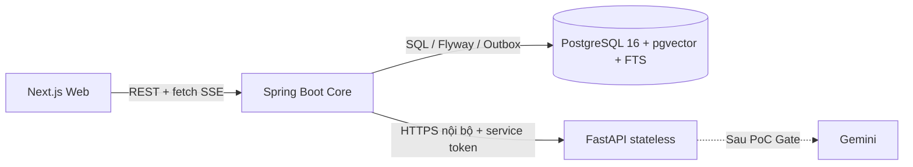

# Ranh giới triển khai

Scaffold chỉ mở health và trạng thái adapter nội bộ. Các mũi tên nghiệp vụ là ranh giới cần triển khai tiếp. Core không có transaction xuyên network. AI không có URL DB hoặc KEK. Compose không publish cổng AI ra host. Redis optional, chưa có client hay state chính thức trong Redis.

Trong Compose development, Core dùng tài khoản PostgreSQL được tạo bởi image để giảm bước khởi tạo. Trước môi trường dùng chung/public cần tách tài khoản migration và runtime, HTTPS/service identity, secret injection và các cổng nghiệm thu tương ứng.
